  

## 💫 About Me

I am a **Software Engineer and Full Stack Developer** who builds web applications with the **MERN stack**, **Node.js APIs** and **Supabase**. I add **AI features** to my products and design the interfaces myself, from Figma mockups to working code.

- 🌐 Building full stack web applications
- 🤖 Integrating AI with the Gemini API
- 🎨 Designing clean, user-friendly UI/UX
- 🎬 Creating digital content, videos and graphics

## 📈 By the Numbers

## 💻 Tech Stack

 

| | |
| :-- | :-- |
| **Frontend** |      |
| **Backend** |    |
| **Databases** |   |
| **AI and CMS** |   |
| **Deployment** |      |
| **Creative** |     |

## 🚀 Featured Projects

<table>
<tr>
<td width="33%" valign="top">
<h4>🧭 SkillSync</h4>
AI-powered job application tracker built with the MERN stack and Gemini AI.  

</td>
<td width="33%" valign="top">
<h4>💬 Code Circle</h4>
A peer code-review social network for developers.  

</td>
<td width="33%" valign="top">
<h4>🗣️ Pucho AI</h4>
Urdu and Roman Urdu AI chatbot with a Video Studio that turns scripts or images into videos.  

</td>
</tr>
<tr>
<td valign="top">
<h4>📄 MatchCV</h4>
Upload a resume and get AI job matches by country and city.  

</td>
<td valign="top">
<h4>☕ Oak &amp; Bean Coffee</h4>
A premium coffee e-commerce website.  

</td>
<td valign="top">
<h4>✅ Smart Task Manager</h4>
A task manager for planning and tracking your work.  

</td>
</tr>
<tr>
<td valign="top">
<h4>🌤️ Skyline Weather</h4>
A weather app that fetches live data from an API.  

</td>
<td valign="top">
<h4>🔗 Synapse API</h4>
RESTful URL shortener API with JWT authentication, link analytics and Swagger docs.  

</td>
<td valign="top">
<h4>🏫 ProSchool ERP</h4>
Multi-school management system with Supabase authentication and row-level security.  

</td>
</tr>
</table>

### 🔗 Spotlight: Synapse, URL Shortener REST API

Developed and deployed a RESTful URL Shortener API using **Node.js** and **Express.js**.

**Key features**

- User registration and login
- JWT-based authentication
- URL shortening and redirect functionality
- Link management and analytics endpoints
- Interactive Swagger API documentation
- Live deployment on Render

**Live API:** [synapse-api-p4y1.onrender.com](https://synapse-api-p4y1.onrender.com) | **API docs:** [api-docs](https://synapse-api-p4y1.onrender.com/api-docs)

**Technologies:** Node.js, Express.js, REST API, JWT, Swagger, Render

## 🧑‍💻 Journey

## 🏅 Certifications

| Certification | Issuer | Date |
| :-- | :-- | :-- |
| **Meta Blueprint Certification** (Meta Ads) | Meta | March 2026 |
| **JavaScript Certification** | freeCodeCamp | October 2026 |

## 📊 GitHub Stats

## ✍️ Random Dev Quote

